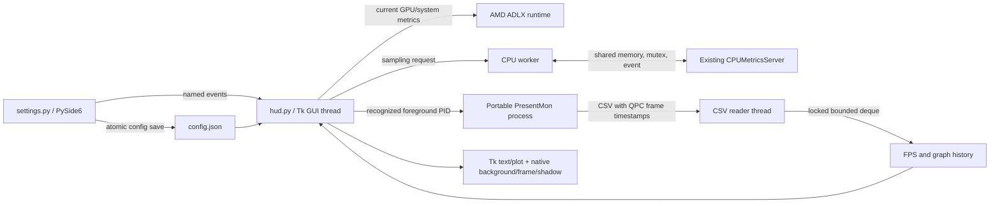

# Architecture

Implementation reference reviewed on 2026-11-07. The project is a Windows desktop
overlay with a separate settings process. It does not modify AMD's own overlay or
hook/inject into a game's graphics API.

## Processes and threads

- The Tk GUI thread owns windows, canvas operations, timers, and the reveal state.
- The CSV worker parses PresentMon output and appends samples under a lock.
- The CPU worker performs potentially blocking private IPC outside Tk callbacks.
- Settings has its own Qt event loop and does not own live ADLX interfaces.
- Qt also rasterizes graph images in the HUD process. Importing Qt for offscreen
  `QImage`/`QPainter` drawing does not introduce a second visible settings window.

## Entry points and startup

| Entry point | Behavior |
| --- | --- |
| `settings.py` / `Settings.cmd` | Open the settings application |
| Desktop `AMD HUD.lnk` | Run `settings.py` with the project's `pythonw.exe` |
| Start menu `AMD HUD.lnk` | Same settings target; created by `Create-StartMenuShortcut.cmd` |
| `hud.py` / `Start-HUD.cmd` | Start one HUD instance for this directory/session |
| `hud.py --probe` | Initialize telemetry, read a snapshot, print JSON, exit |
| `hud.py --probe-game` | Read foreground/profile recognition, print JSON, exit |
| `hud.py --smoke-test` | Show a temporary HUD, require at least two successful reads |
| `Check-ADLX.cmd` | Run `--probe` and pause the console |

`main()` acquires a directory-specific mutex for ordinary HUD/smoke runs, loads the
config, initializes `Monitor`, creates control events, and enters `show_hud()`.
The diagnostic probe modes do not acquire the HUD instance mutex. A duplicate HUD
prints an already-running message and exits successfully; that is not a new smoke test.

The mutex name includes a hash of the normalized absolute directory and uses the
Windows `Local` namespace. Separate copies in different directories have separate
mutexes, but global hotkey combinations can still conflict.

## Control protocol and reload

`HudControl` exposes three named auto-reset events: `stop`, `reload`, and `preview`.
Their names derive from the same project identity as the mutex. Polling consumes an
event once. `running()` checks for the HUD mutex; merely opening settings/control
events does not make a HUD appear to be running.

- `stop`: leave the GUI loop, release resources, exit.
- `reload`: close the current HUD session, release the old monitor, load saved config,
  initialize a new monitor, and create new HUD windows while keeping the mutex.
- `preview`: clear manual hiding and permit visibility outside games for ten seconds.

These events are local coordination, not a network API. Reload reads configuration;
it does not reload Python modules. Source changes require a process restart to take effect.

## Independent schedules and clock domains

| Work | Timing | Clock |
| --- | --- | --- |
| Numeric telemetry/FPS/API text | `refresh_ms`, normally 1000 ms | Tk scheduling |
| Foreground detection and layer visibility | 200 ms | `monotonic()` for preview expiry |
| AMD profile reload | At most once per 5 seconds | `monotonic()` |
| Hotkeys/control events | 100 ms | Tk scheduling; preview expiry uses `monotonic()` |
| Visible graph animation | Target about 60 Hz; subtract render time from delay | `perf_counter()` |
| Hidden graph callback | 200 ms; no plot rasterization | Tk scheduling |
| CPU requests | At most one attempt per second; result freshness 2.5 seconds | `monotonic()` |
| Frame timing, FPS freshness, capture retry, reveal | QPC seconds | `perf_counter()` |
| Settings running-state display | Qt timer, 750 ms | Qt scheduling |

QPC and `perf_counter()` were verified to share the frame timing domain on this
runtime. `monotonic()` uses `GetTickCount64()` here and must not be subtracted from
QPC frame times. The unrelated preview/CPU timers do not need QPC precision.

## GPU, system telemetry, and presentation

`Monitor` initializes the ADLX helper, selects `gpu_index`, obtains performance
services and GPU support flags, and reads current measurements. Unsupported GPU
metrics return `None`. CPU usage and system RAM come from ADLX system metrics;
RAM is converted by dividing the returned value by 1024 for the `GiB` display.
CPU temperature uses the separate adapter described below.

FPS is not an ADLX metric in this implementation. `Monitor.read()` leaves it empty;
the HUD fills it from PresentMon. `format_layout()` produces four base rows and an
optional LSFG output row. Requesting additional diagnostic GPU metrics does not add automatic rows.

The numeric frame interval beside FPS is `1000 / displayed_fps`, not necessarily
the latest plotted sample. Text follows `refresh_ms`; the plot animates independently.
FPS, RAM, and frame-interval text have one space before the unit, for example
`60 FPS`, `12.5 GiB`, and `16.7 ms`.
The API label maps `DXGI` to `DirectX`, `D3D9` to `DirectX 9`, and otherwise uses the
reported runtime or `FPS`. DXGI does not identify DirectX 11 versus DirectX 12.

On cleanup, clear native interface references and collect them before terminating
ADLX. `None` values become `N/A`; a telemetry exception clears displayed readings
and writes an English error to stderr.

## PresentMon and FPS

`FpsCounter.target(pid)` starts the vendored PresentMon executable with a PID filter,
stdout CSV, legacy v1 metrics, QPC timestamps, and GPU/input/display tracking
disabled. Game FPS and the graph need Present intervals, so they do not wait for
display completion. The auxiliary LSFG counter retains display tracking.
Its ETW session is named `AMDHUD-<hud-process-id>`. The reader retains up to 32768
`(qpc_seconds, swap_chain, milliseconds_between_presents)` samples in memory.

- Only finite positive intervals for the requested PID are accepted.
- CSV arrival time is not used as the frame timestamp. A bounded 256-source
  delivery-health map separately records arrival time only when a chain advances.
- A snapshot is copied under the lock; graph work happens after releasing it.
- FPS uses samples no older than 1.5 seconds and the most numerous swap chain.
  Formula: `1000 * sample_count / sum(interval_ms)`.
- Graph source selection initially chooses the dominant recent swap chain. An active
  source is retained unless stale or a challenger remains at least 1.5x as active
  for at least 0.5 seconds. Source counts cover 1.5 seconds relative to each live
  chain's latest measured frame. A source change starts at the latest measured
  timestamp of the selected chain, never at the later CSV receipt time.
- Graph and numeric FPS source selection are related but not identical: the latter
  recomputes the dominant group without graph hysteresis.
- With no samples within 1.5 seconds, numeric FPS is unavailable. The graph can
  retain measured history from a delayed but advancing delivery stream: the latest
  measured frame must be at most 3 seconds old and advancing data must have arrived
  within 1.5 seconds. Ancient batches or a stopped stream return to waiting.
- After a consumer starts, restarts of an ended consumer are throttled for the same
  PID for five seconds. An executable launch exception is a startup failure, not a
  guaranteed automatic-retry path.

Stopping terminates the owned consumer, waits/joins its reader, and asks PresentMon
to terminate only that named ETW session. It clears history/source state. Capture is
needed when either FPS text or the graph is enabled, but only a recognized foreground
game supplies a PID, including in desktop preview mode.

## Lossless Scaling output

`LosslessScalingDetector` requires an already recognized foreground game. It locates
visible, non-minimized native windows of exact class `LosslessScaling`, verifies
`LosslessScaling.exe` as their owning executable, and requires the same monitor as
the game. The observed `LosslessScalingBlk` backing window and WPF settings windows
do not qualify. LS remains excluded from game recognition; its presence cannot
make the HUD visible over a desktop app. No private LS IPC or DLL calls are used.

When FPS text is enabled, active LS output gets its own `FpsCounter(displayed=True)`
with ETW session `AMDHUD-<hud-process-id>-LSFG`, `--exclude_dropped`, and the LS PID.
The reader uses finite positive `msBetweenDisplayChange` values for FPS and timestamps
them with `QPCTime / frequency + msUntilDisplayed / 1000`. Dropped frames and missing,
non-finite, or negative display timing are rejected without a rendered-FPS fallback.
The displayed total includes original and generated output; output detection does
not establish which LS frame-generation mode is configured. Swap chains are never
summed. Game FPS and graph capture retain their existing Present intervals.

The source identity includes game PID, LS PID, and native output HWND. A change clears
auxiliary capture before starting fresh, even if the LS process is reused. Hiding or
stopping scaling stops the owned LS capture. A missing fresh measurement shows N/A.
The automatic fifth row uses the FPS accent, adds one line height, and moves the
existing graph items below it without recreating the plot image or reveal state.
Removing the row restores the base height. Native backing layers follow the resize.

## Graph rendering pipeline

1. The GUI requests 8.5 seconds of history: seven visible seconds plus 1.5 seconds
   of allowance for a reveal cursor behind delivery.
2. `GraphReveal` sorts valid received samples and starts at the first sample. Each
   callback advances a separate viewport clock at elapsed QPC time (1x speed).
   The drawing cursor is capped by both that viewport and the latest known frame.
   Playback keeps a 250 ms delivery buffer. If delivery runs dry, only drawing
   stops: measured history continues scrolling left, leaving an empty right edge.
3. Confirmed samples up to the cursor are visible. If the cursor is inside a known
   straight segment, the segment is clipped at that cursor. This endpoint is purely
   graphical; it does not become a captured sample or min/max measurement.
4. `graph_columns()` reduces peaks into absolute-time buckets roughly one pixel wide.
   Its bin membership does not change merely because the viewport scrolls.
5. The visible drawing tip is retained after reduction. `GraphScale` immediately
   makes room for a larger real range, then contracts with a 0.75 second exponential
   time constant. The baseline upper range is at least 16.7 ms.
6. `render_plot()` uses Qt antialiasing and straight `QPainterPath.lineTo()` segments.
   It renders a 1.25 px stroke with round caps/joins into an RGB image matching Tk's
   color key. PNG bytes update only the hidden member of a reusable pair of
   `PhotoImage` buffers. After decoding finishes, the existing canvas image item
   switches to that buffer. The displayed photo is never reconfigured in place,
   and waiting/line visibility changes only after the first image is ready.

The viewport is seven seconds relative to its independent scrolling clock, starting
at the first sample. Delivery/animation latency means it is not a promise of a
zero-delay view of wall-clock time. When data runs out, the drawing cursor stops
at the last received frame while the viewport keeps scrolling; no line is extrapolated.
The graph delivery-health gate tolerates bounded CSV latency while still returning
a stopped stream or frames older than 3 seconds to waiting.
The bounded sample deque also limits retained history at exceptionally high rates.

## Visibility and layered composition

Game recognition resolves the current foreground process to its full normalized
executable path. `gmdb.blb` is read as JSON despite its extension. AMD profiles are
merged with manual paths after excluding removed, launcher, app/link/AI entries and
excluded names. Missing or partially rewritten profiles never authorize desktop
visibility; manual paths continue to work.

The Tk root begins withdrawn. `prevent_window_activation()` installs a thread-local
CBT hook before root creation and rejects activation/focus operations on that thread.
`HudWindowVisibility` maps the client and wrapper with non-activating native calls.
While visible, the 200 ms visibility poll also restores the text window's topmost
position before synchronizing backing layers. This handles a game raising its
window without a foreground PID or visibility change. Hidden windows stay hidden.
Native layers use non-activating styles and pass hit tests through to the game.

Text/graph, smooth background/border, optional Acrylic, and optional shadow are
separate windows. Frame/shadow pixels use premultiplied BGRA with fractional edge
coverage and `UpdateLayeredWindow`. Size-dependent geometry is cached. Acrylic
uses `composition_backdrop.RoundedBackdrop`: a Windows Composition host-backdrop
brush beneath a color tint, both clipped by `CompositionRoundedRectangleGeometry`.
The radius is clamped only to half the window dimensions, matching the frame/shadow.
The host window enables `DWMWA_USE_HOSTBACKDROPBRUSH`, disables fixed DWM corners,
and never applies a GDI region. Windows 11 host-backdrop support is required;
initialization failure retains the plain-background fallback and diagnostic.

The WinRT ABI is declared through ctypes using SDK interface IDs and vtables,
without adding a runtime package or build requirement. A dispatcher queue belongs
to the GUI thread and survives config reloads; each backing window owns its
compositor, desktop target, brushes, visuals, and clip references. Closing detaches
and closes the target/compositor before releasing references and destroying its
HWND. At process shutdown the owned dispatcher drains before WinRT uninitializes.
See Microsoft's [Win32 visual-layer integration](https://learn.microsoft.com/en-us/windows/uwp/composition/using-the-visual-layer-with-win32)
and [host-backdrop brush](https://learn.microsoft.com/en-us/uwp/api/windows.ui.composition.compositor.createhostbackdropbrush) documentation.

Visibility, manual hide, preview override, and capture are coordinated in the 200 ms
poll. Showing clears previous text/graph; hiding skips ordinary telemetry reads and
stops capture. A switch directly between recognized game PIDs resets the counter;
the next graph update clears or replaces its history.

## CPU temperature adapter

This is private, version-specific IPC, not a documented ADLX CPU-temperature API.
`cpu_temperature.py` is the authority for the accepted server SHA-256 and mapping name.
The adapter expects the existing server at `%ProgramFiles%\AMD\CNext\CNext` and does
not start/install it. Unknown/missing binaries are rejected.

| Field | Packet location / check |
| --- | --- |
| Packet size | `0x1F8` bytes |
| Telemetry request byte | Offset `0x00`; accept original 0/1, temporarily set 1 |
| Sample counter | Unsigned 32-bit at `0x1C0`; must change |
| Supported flag | Unsigned 16-bit at `0x78`; must equal 1 |
| Expected maximum | Double at `0x68`; must equal 120.0 |
| Temperature | Double at `0x1D8`; finite and `0 < value <= maximum` |

The worker opens the shared mapping, event, and mutex; requests sampling and waits
up to 0.8 seconds for a changed counter. It attempts to restore the original byte
under the mutex even on failure. Failure to reacquire the mutex is reported; restore
cannot be guaranteed if the external server never releases it. No tuning fields are
intentionally changed. Handles/views are released and worker shutdown is requested.

## Settings persistence and fonts

Border and Shadow use `CollapsibleSection`: an inline keyboard-accessible disclosure
header and a transparent content widget. Both start expanded on first use.
`QSettings` stores window size, section expansion, and the selected tab in project-local
`settings-ui.ini`, restoring them without animation when creating the editor.
Section/tab changes are synced immediately; window resizing is debounced by 250 ms
and flushed on accepted close. Maximizing/minimizing preserves the normal window size.
UI state is independent of HUD configuration, dirty state,
or enabled effects. Write failures are reported in the editor and stderr.
Controls stay alive with their buffered values. A validation error expands the owning
section before focusing its invalid number field.

`ui_motion.py` supplies painted Qt buttons, checkboxes, input borders, tab selection,
smooth wheel scrolling, and page/status fades. `MotionValue` retargets interruptible
`QVariantAnimation` instances from their current value with OutCubic easing. It blocks
intermediate configuration signals when resetting playback time to avoid reversal jumps.
Native button/checkbox input semantics and signal delivery remain immediate.

Section height animation changes a `RevealViewport` clipping wrapper, leaving its
inner form at full height. This prevents grid compression and overlapping labels.
The chevron follows reveal progress; validation can finish expansion synchronously.
Page opacity effects are applied to scroll viewports; independent status-label effects
sit outside those pages to avoid nested opacity captures. Press feedback moves only
painted content by less than a pixel, leaving hit areas and layout unchanged.

Durations are approximately 65 ms for press response, 130–150 ms for hover/focus,
170 ms for fades/checkmarks, 180 ms for tab sliding, and up to 220 ms for section
reveal. Smooth wheel scrolling targets 140 ms; precise trackpad pixel deltas retain
native handling. New input interrupts prior transitions. There is no blocking sleep
or per-frame stylesheet regeneration. Windows client-area animation preference is
queried read-only and disables these transitions when motion is turned off.
The existing slow Save glow runs only while the dirty button is visible and motion
is permitted. Settings animation does not modify HUD graph timing or saved values.

Settings loads a digest-checked snapshot. Controls edit a separate buffer; dirty state
compares collection against the snapshot and adds a bullet to the title. Save validates,
writes `.config-<pid>.tmp`, checks the expected digest, atomically replaces the JSON,
then signals a running HUD to reload. This is conflict detection, not a cross-process
transactional file lock: a narrow check-to-replace race remains possible.

Font support parses SFNT name tables and privately adds/removes the selected TTF/OTF
using GDI. The file stays at its user-selected path. Tk owns its font objects; the
panel releases its private font on destruction. Settings separately bundles Noto Sans.

## Limitations and verification boundaries

- Windows/native driver availability is required; this is not a portable Linux/macOS UI.
- Windowed, borderless, and Windows-composited fullscreen presentation are targeted.
  Legacy exclusive paths bypassing desktop composition cannot show these windows.
  A game's Fullscreen label alone does not identify its presentation path. Actual
  fullscreen/HDR compatibility still needs per-game manual observation.
- CPU server updates can intentionally disable CPU temperature until reviewed.
- Rendered FPS need not include generated/interpolated frames.
- Graph animation targets 60 Hz; blocking telemetry/capture cleanup and scheduler
  delays can lower actual cadence. There is no hard real-time guarantee.
- No automatic code reload, installer, automatic dependency downloader, or telemetry
  upload service is implemented.
